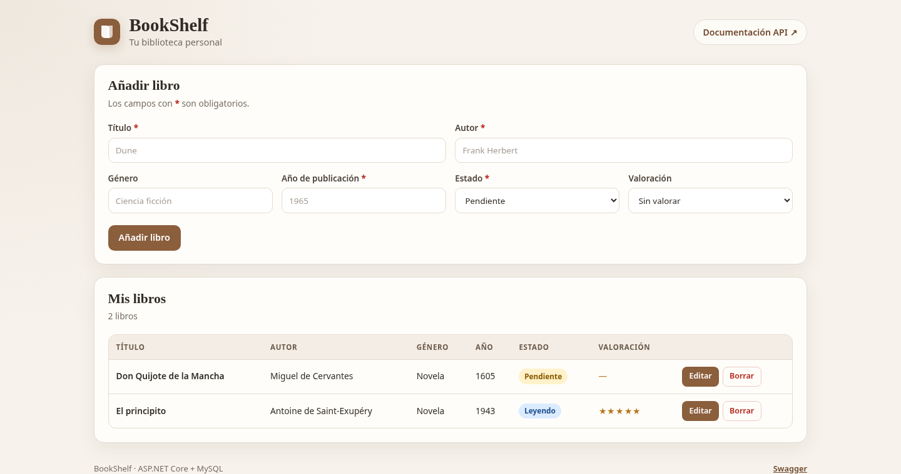

# BookShelf API


API REST para gestionar una biblioteca personal de libros, construida con C#, ASP.NET Core Web API, Entity Framework Core y MySQL.

La aplicación permite registrar libros, consultarlos, actualizarlos y eliminarlos desde una interfaz web sencilla o directamente contra la API, con validaciones y respuestas de error coherentes.

## Estado del proyecto

**v1 — CRUD completo sobre MySQL + interfaz web mínima.** Filtros, búsqueda, estadísticas y pruebas automatizadas quedan planificados para las siguientes versiones (ver [Roadmap](#roadmap)).

## Funcionalidades

- CRUD completo de libros.
- Interfaz web mínima para listar, crear, editar y eliminar libros.
- Validación de título, autor, año de publicación, valoración y estado de lectura.
- Búsqueda por ID y listado ordenado por título.
- Estado de lectura modelado como enum: `Pending`, `Reading` y `Read`.
- Respuestas de error homogéneas con `ProblemDetails` (RFC 7807).
- Documentación interactiva con Swagger UI.
- Acceso a datos asíncrono con EF Core.
- Credenciales de base de datos fuera del repositorio mediante user-secrets.
- Migraciones de EF Core para versionar el esquema.

## Tecnologías

| Tecnología | Versión | Uso |
|---|---|---|
| .NET | 10.0 (LTS) | Plataforma de ejecución |
| ASP.NET Core Web API | 10.0 | Endpoints HTTP |
| Entity Framework Core | 10.0.9 | Acceso a datos y migraciones |
| MySql.EntityFrameworkCore | 10.0.9 | Proveedor oficial de MySQL para EF Core |
| MySQL | 8.4 LTS (probado con 8.4.10) | Base de datos relacional |
| Swashbuckle.AspNetCore | 10.3.1 | Swagger UI y documento OpenAPI |
| HTML, CSS y JavaScript | nativo | Interfaz web sin framework ni compilación |

### Por qué estas versiones

- **.NET 10 es LTS** (soporte hasta noviembre de 2028). .NET 9 es una versión STS cuya ventana de soporte termina en noviembre de 2026, por lo que no es una buena base para un proyecto a medio plazo.
- **Proveedor oficial de MySQL**: Pomelo, el proveedor comunitario habitual, todavía no publica una versión estable para EF Core 10. El paquete `MySql.EntityFrameworkCore` de Oracle es el proveedor compatible con EF Core 10 en el momento de crear el proyecto.
- **Swashbuckle** se usa para generar el documento OpenAPI y servir Swagger UI en la misma aplicación.
- **DataAnnotations** es suficiente para las validaciones de esta versión; no se añadió FluentValidation para evitar una dependencia extra.
- **Sin AutoMapper**: el mapeo entre entidades y DTOs son pocas líneas explícitas, fáciles de leer y de depurar.

## Arquitectura

```text
BookShelf/
├── BookShelf.sln
├── dotnet-tools.json          # Versión local de dotnet-ef
├── README.md
├── .gitignore
├── docs/
│   └── images/                # Capturas para el README
└── src/
    └── BookShelf.Api/
        ├── Controllers/       # Endpoints HTTP
        ├── Data/
        │   ├── BookShelfDbContext.cs
        │   ├── Configurations/  # Configuración Fluent API de las entidades
        │   └── Migrations/      # Migraciones de EF Core
        ├── Dtos/              # Contratos de entrada y salida
        ├── Mappings/          # Conversión entre entidad y DTOs
        ├── Models/            # Entidad Book y enum ReadingStatus
        ├── Services/          # Lógica de negocio y consultas EF Core
        ├── Program.cs         # Configuración de la aplicación
        ├── appsettings.json
        ├── BookShelf.http     # Peticiones de ejemplo
        └── wwwroot/           # Interfaz web (HTML, CSS y JS)
            ├── index.html
            ├── styles.css
            └── app.js
```

Flujo de una petición:

```text
Navegador (HTML/CSS/JS)
   │ fetch('/api/books')
   ▼
HTTP → BooksController → BookService → BookShelfDbContext → MySQL
                              ↓
                    Book → BookResponseDto
```

- El **controller** solo se ocupa del protocolo HTTP: rutas, códigos de estado y `Location`.
- El **service** concentra las consultas y la lógica de negocio; no se creó una interfaz porque todavía no hay otras implementaciones ni necesidad de sustituirlo en pruebas.
- Los **DTOs** evitan exponer la entidad de base de datos y permiten validar la entrada sin contaminar el modelo de persistencia.
- La **entidad** `Book` y su configuración viven en `Models` y `Data/Configurations`.

## Requisitos previos

- [.NET SDK 10.0](https://dotnet.microsoft.com/download) (probado con 10.0.402).
- MySQL 8.0 o superior (probado con MySQL 8.4.10 LTS). También puedes usar un servidor MySQL en Docker.
- `dotnet-ef` 10.0.9. El repositorio incluye un manifiesto local, así que basta con `dotnet tool restore`.
- La interfaz web no requiere Node ni un servidor aparte: son archivos estáticos servidos por la API.

## Instalación y configuración

### 1. Clonar el repositorio

```bash
git clone https://github.com/sburgos28/BookShelf.git
cd BookShelf
dotnet restore
dotnet tool restore
```

### 2. Crear la base de datos y el usuario

Conéctate a MySQL como administrador y ejecuta:

```sql
CREATE DATABASE IF NOT EXISTS bookshelf
  CHARACTER SET utf8mb4
  COLLATE utf8mb4_0900_ai_ci;

CREATE USER IF NOT EXISTS 'bookshelf'@'localhost'
  IDENTIFIED BY 'TU_PASSWORD';

GRANT ALL PRIVILEGES ON bookshelf.* TO 'bookshelf'@'localhost';
FLUSH PRIVILEGES;
```

> `utf8mb4` es el conjunto de caracteres recomendado en MySQL: permite tildes, eñes y emojis. La colación `utf8mb4_0900_ai_ci` es la predeterminada de MySQL 8.

### 3. Configurar la cadena de conexión

La cadena de conexión **no se guarda en el repositorio**. Se configura con user-secrets, que almacena los valores en el perfil del usuario, fuera del proyecto:

```bash
dotnet user-secrets set "ConnectionStrings:DefaultConnection" \
  "Server=localhost;Port=3306;Database=bookshelf;User ID=bookshelf;Password=TU_PASSWORD;SslMode=Preferred;" \
  --project src/BookShelf.Api
```

El proyecto ya incluye un `UserSecretsId` en el `.csproj`; no hace falta ejecutar `user-secrets init`.

> Si tu servidor MySQL escucha en otro puerto, cambia `Port=3306` por el que corresponda.

Si prefieres no usar user-secrets, también puedes definir la variable de entorno:

```bash
export ConnectionStrings__DefaultConnection="Server=localhost;Port=3306;Database=bookshelf;User ID=bookshelf;Password=TU_PASSWORD;SslMode=Preferred;"
```

> Para un entorno real, usa un usuario con privilegios mínimos, una contraseña robusta y TLS (`SslMode=Required` o superior). `SslMode=Preferred` facilita el desarrollo local con certificados autofirmados.

### 4. Aplicar las migraciones

```bash
dotnet ef database update \
  --project src/BookShelf.Api \
  --startup-project src/BookShelf.Api
```

Esto crea la tabla `books` y la tabla de historial de migraciones de EF Core.

### 5. Ejecutar la aplicación

```bash
dotnet run --project src/BookShelf.Api
```

La aplicación escucha en `http://localhost:5080`.

- Interfaz web: <http://localhost:5080/>
- Swagger UI: <http://localhost:5080/swagger>
- Documento OpenAPI: <http://localhost:5080/swagger/v1/swagger.json>

## Endpoints

| Método | Ruta | Descripción | Respuesta correcta |
|---|---|---|---|
| `GET` | `/api/books` | Lista todos los libros ordenados por título | `200 OK` |
| `GET` | `/api/books/{id}` | Obtiene un libro por ID | `200 OK` |
| `POST` | `/api/books` | Crea un libro | `201 Created` + `Location` |
| `PUT` | `/api/books/{id}` | Actualiza todos los datos de un libro | `200 OK` |
| `DELETE` | `/api/books/{id}` | Elimina un libro | `204 No Content` |

Errores:

- `400 Bad Request`: datos inválidos. Devuelve un `ValidationProblemDetails` con los campos afectados.
- `404 Not Found`: el ID no existe. Devuelve un `ProblemDetails` con un mensaje descriptivo.

### Modelo de datos

| Campo | Tipo | Obligatorio | Reglas |
|---|---|---|---|
| `id` | entero | Sí (generado) | Clave primaria autoincremental |
| `title` | texto | Sí | Máximo 200 caracteres |
| `author` | texto | Sí | Máximo 150 caracteres |
| `genre` | texto | No | Máximo 100 caracteres |
| `publicationYear` | entero | Sí | Entre 1 y el año actual |
| `readingStatus` | texto | Sí | `Pending`, `Reading` o `Read` |
| `rating` | entero | No | Entre 1 y 5 |
| `createdAt` | fecha/hora | Sí (generado) | Se asigna en el servidor, en UTC |

## Ejemplos de peticiones

### Crear un libro

```bash
curl -i -X POST http://localhost:5080/api/books \
  -H "Content-Type: application/json" \
  -d '{
    "title": "Dune",
    "author": "Frank Herbert",
    "genre": "Ciencia ficción",
    "publicationYear": 1965,
    "readingStatus": "Read",
    "rating": 5
  }'
```

Respuesta `201 Created`:

```json
{
  "id": 1,
  "title": "Dune",
  "author": "Frank Herbert",
  "genre": "Ciencia ficción",
  "publicationYear": 1965,
  "readingStatus": "Read",
  "rating": 5,
  "createdAt": "2026-10-20T20:44:40.809396Z"
}
```

### Listar libros

```bash
curl http://localhost:5080/api/books
```

### Obtener un libro

```bash
curl http://localhost:5080/api/books/1
```

### Actualizar un libro

`PUT` reemplaza todos los datos editables del libro:

```bash
curl -i -X PUT http://localhost:5080/api/books/1 \
  -H "Content-Type: application/json" \
  -d '{
    "title": "Dune",
    "author": "Frank Herbert",
    "genre": "Ciencia ficción",
    "publicationYear": 1965,
    "readingStatus": "Reading",
    "rating": 4
  }'
```

### Eliminar un libro

```bash
curl -i -X DELETE http://localhost:5080/api/books/1
```

Respuesta `204 No Content`. Si el ID no existe, devuelve `404` con:

```json
{
  "title": "Libro no encontrado",
  "status": 404,
  "detail": "No existe ningún libro con el ID 1.",
  "instance": "/api/books/1"
}
```

### Ejemplo de error de validación

```bash
curl -i -X POST http://localhost:5080/api/books \
  -H "Content-Type: application/json" \
  -d '{
    "title": "Libro sin autor",
    "publicationYear": 3000,
    "readingStatus": "Finished"
  }'
```

Respuesta `400 Bad Request`:

```json
{
  "title": "Datos de entrada no válidos",
  "status": 400,
  "instance": "/api/books",
  "errors": {
    "Author": ["El autor es obligatorio."],
    "PublicationYear": ["El año de publicación debe estar entre 1 y 2026."],
    "ReadingStatus": ["El valor del campo 'readingStatus' no es válido."]
  }
}
```

> El año máximo del mensaje se calcula con el año actual del servidor.

## Cómo probar la aplicación

1. Ejecuta la aplicación con `dotnet run --project src/BookShelf.Api`.
2. Abre la interfaz web en <http://localhost:5080/>. Desde ahí puedes crear, editar y eliminar libros.
3. Para probar la API directamente, abre <http://localhost:5080/swagger>. Despliega cada endpoint, pulsa **Try it out**, rellena el JSON y pulsa **Execute**.
4. Alternativamente, abre `src/BookShelf.Api/BookShelf.http` en Visual Studio o VS Code con la extensión REST Client y ejecuta las peticiones desde el editor.

Comandos útiles:

```bash
# Compilar
dotnet build

# Ver el estado de las migraciones
dotnet ef migrations list --project src/BookShelf.Api

# Crear una migración nueva después de cambiar el modelo
dotnet ef migrations add NombreDeLaMigracion \
  --project src/BookShelf.Api \
  --output-dir Data/Migrations

# Revertir la última migración aplicada
dotnet ef database update NombreMigracionAnterior \
  --project src/BookShelf.Api
```

## Decisiones técnicas

- **DTOs en lugar de entidades en la API.** La entidad `Book` es un detalle de persistencia. Los DTOs permiten validar la entrada y controlar exactamente qué campos se devuelven.
- **Enum almacenado como texto.** La columna `reading_status` guarda `Pending`, `Reading` o `Read`, no números. Es más legible al inspeccionar la base de datos y más resistente a reordenamientos del enum.
- **Enums como string en JSON.** `JsonStringEnumConverter` hace que la API acepte y devuelva `"Read"` en lugar de `2`, y rechaza valores numéricos o desconocidos.
- **Fechas en UTC.** `CreatedAt` se genera con `DateTime.UtcNow`. MySQL no conserva `DateTimeKind`, así que el mapeo lo marca explícitamente como UTC al leerlo.
- **Validación en los DTOs.** `DataAnnotations` cubre las reglas simples y `IValidatableObject` valida que el año no sea futuro. El controller no repite estas comprobaciones.
- **`ProblemDetails` para errores.** Los errores de validación generados por `[ApiController]` se normalizan en `Program.cs` para que todos los `400` tengan el mismo formato y mensajes en español.
- **Respuestas asíncronas.** Todas las operaciones de EF Core usan `async`/`await` y aceptan un `CancellationToken`.
- **Sin capas innecesarias.** No hay repositorio genérico, AutoMapper ni interfaz de servicio: el proyecto es pequeño y cada abstracción tendría que justificar su coste.
- **Interfaz sin framework.** HTML, CSS y JavaScript nativo en `wwwroot`. Consume la misma API con `fetch`, no necesita Node ni un servidor aparte y evita configurar CORS.
- **Credenciales fuera del repositorio.** La cadena de conexión se obtiene de user-secrets o de variables de entorno; `appsettings.json` no contiene contraseñas.

## Capturas



La captura muestra la interfaz servida en `http://localhost:5080/`. Para añadir más capturas (Swagger, una petición concreta), guárdalas en `docs/images/` y enlázalas desde aquí.

## Roadmap

### v2 — Búsqueda y estadísticas

- Buscar por título o autor (`?search=`).
- Filtrar por género (`?genre=`) y estado de lectura (`?status=`).
- Combinar filtros.
- Estadísticas: total, pendientes, en lectura, leídos y distribución por género.
- Índices en las columnas usadas por los filtros.
- Mostrar los filtros y las estadísticas en la interfaz web.

### v3 — Calidad y documentación

- Pruebas unitarias e integración.
- Paginación y metadatos en los listados.
- CI con GitHub Actions (build y tests).
- Capturas y documentación final del repositorio.

### Mejoras futuras

- Autenticación y autorización por usuario.
- Frontend para consumir la API.
- Docker Compose para levantar API y MySQL con un comando.
- Búsqueda avanzada, ordenación configurable y exportación de datos.

## Autor

Santiago Burgos ([@sburgos28](https://github.com/sburgos28)).
